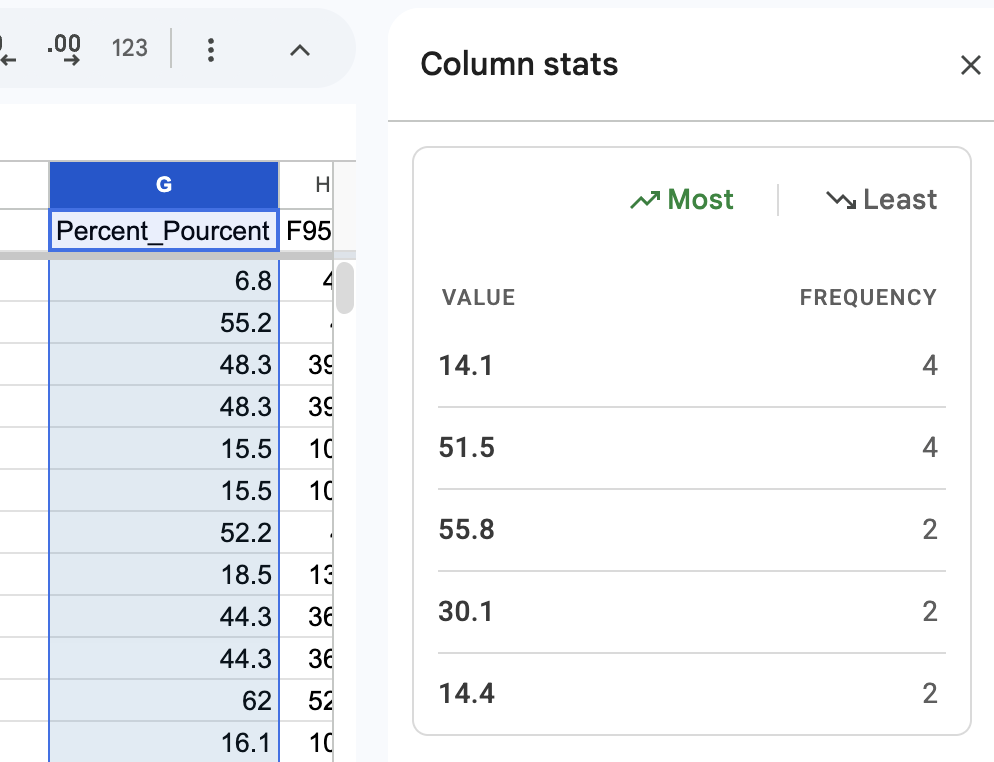
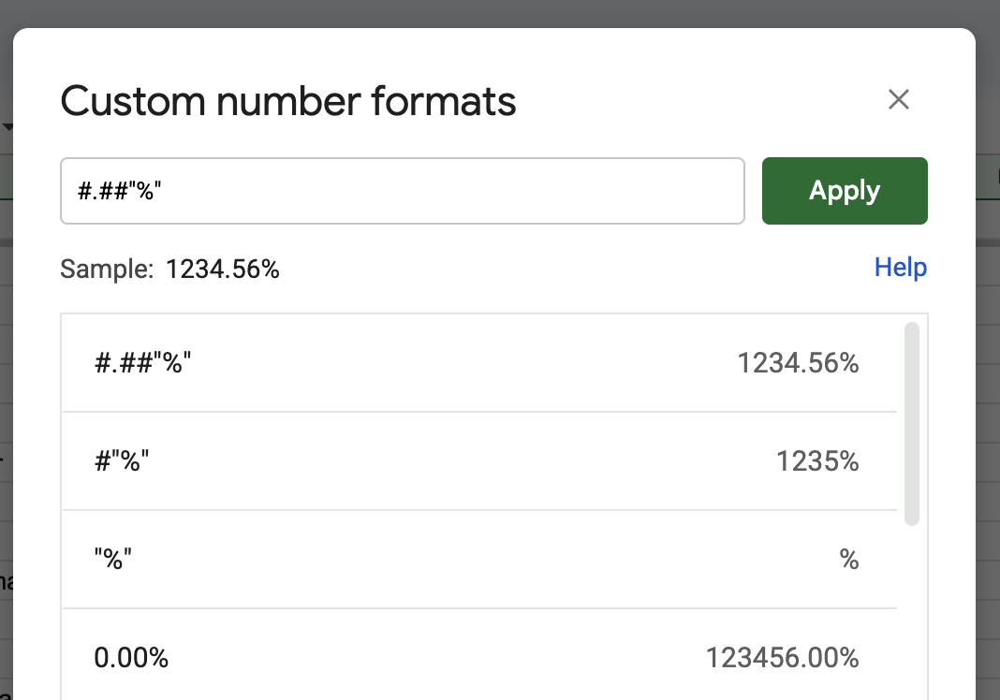
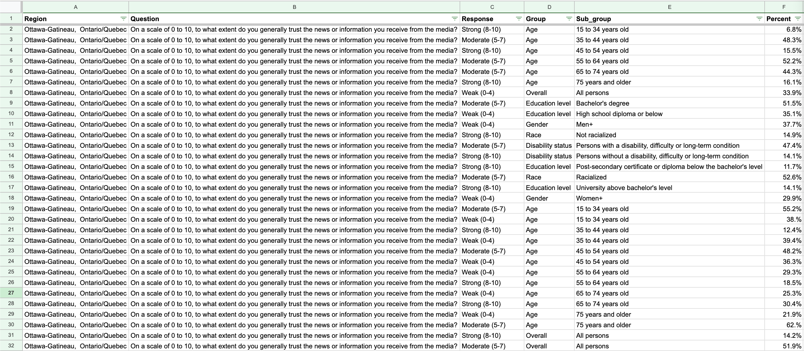
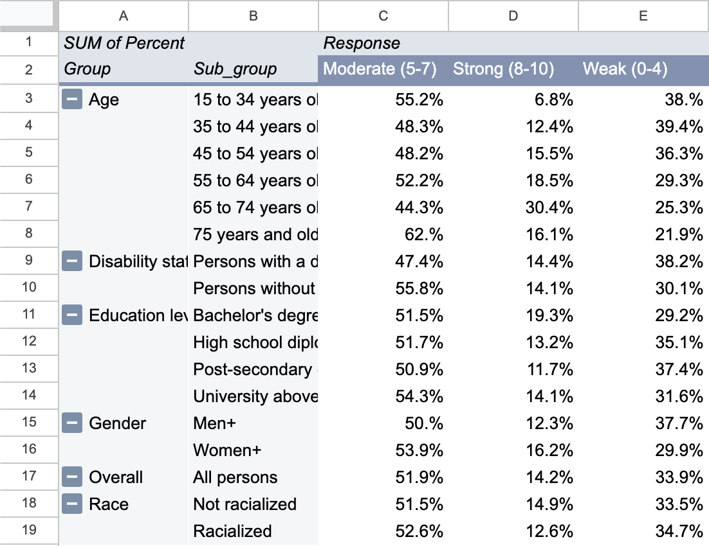
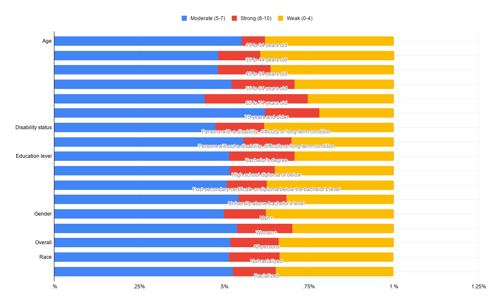

November 5th, 2026 
MPAD 2003 - Introductory Data Storytelling 
Emma Maxwell 
Jean-Sébastien Marier 

# Artifical Intelligence Is Giving Us Trust Issues

## Foreword
The intent of this article is to connect the relevance of society's current trust in the media and the role that Artificial Intelligence is playing in that. I hope to open the eyes of all generations to the harm that AI is doing within the media sphere, and subsequently, our trust. 

## Getting Data

This assignment is dedicated to analyzing a dataset from Ottawa's open data website. The dataset I'm looking at is titled ["Trust in Media"](https://open.ottawa.ca/datasets/ottawa::trust-in-media/about) and displays the level of trust respondents have in the news and information that they are consuming through the media. 

While there are many ways to import a dataset directly from a webpage using functions like `IMPORTHTML` or `IMPORTDATA`, I found that the only way to import this table was to use the built-in import function from Google Sheets. To do this, open a new sheet file, go to the File tab on the top left, click the third option, Import data; from there, you can select a file from multiple options. I chose to upload it from my computer. Once you open that file, Google Sheets will ask you if you would like to select the location of the sheet and the separator type. I chose to insert the new sheet and detect automatically. The sheet is now imported and will look something like this:
 

The dataset is configured into a table with 13 columns and 102 rows of entries. The columns are organized by year, region, question being given to each respondent, response with a scale, group type, sub-group type, percent, 95lcl (lower confidence level), 95ucl (upper confidence level), language, and objectID. From an initial glance, the data looks very messy; there are submissions in both French and English, data is organized into groups and then subgroups of that, and some categories are hard to decipher what they really mean or equate to, like the percent column. Overall, the data is quite hard to follow and make logical at the moment. 

The "response" category contains ordinal variables consisting of 3 different response ranges: weak/faible (0-4), moderate/moderee (5-7), and strong/forte (8-10). These are the scores that the respondent gave on how much they trust the news and information from the media currently. 
The "group" category is organized as nominal variables, describing the demographics of the respondents who submitted the response. These groups are categorized as Age, disability status, education level, gender, race, and overall. 
The "percent" column contains continuous numerical variables. They are percentages between 0 and 100, but there is no quantifiable logic being given about what the percent is telling us. Is it the percent of how many people from the specific group chose that response range? 

One thing I am questioning at the moment is whether every entry is in both English and French, or if they are French or English depending on where the respondent group was from.

## 2. Understanding Data
### 2.1. VIMO Analysis

After a brief analysis of the "response" category's column stats, I determined that the column is all valid. It contains 6 unique values, all of which add up to 102, being the total value of rows in the dataset. No cells are invalid, missing or have any outliers.

The "group" column is mostly valid, with a couple of outlier values. While there are some differences between values of all groups, the "overall" group has a significantly lower value than the rest. There are only 3 "overall" entries, while everything else averages around 8.5. Besides this, there are no missing or invalid cells. 

The "percent" category is also mostly valid. There are 49 unique values, which makes sense because the values are all continuous numerical variables. What makes this more interesting though, is that there are two outlier values, meaning there are two percent values that repeat. 
   
One of the outlier values is 14.1%, repeating four times (two per language). One of the entries was for the group "disability status", the other being "education level", both with the response strong(8-10). The other value is 51.5%, also repeating four times (two per language). One entry for "education level" and the other is "race", both with a response of moderate(5-7). There are no missing or invalid cells. 

### 2.2. Cleaning Data

The first thing I do whenever I clean a data set is freeze the top row where all of the column headers live. This allows me to scroll down the sheet and still be able to see what the columns are. To do this, I click on 1:1, and it will highlight the entire first row. 
  

While that row is hightlighted I then go to `View > Freeze > 1 Row`. This freezes the whole row. While the row is still highlighted, I am also going to apply a filter to it. While it is highlighted, go to `Data > Create A Filter`. The first row is now frozen and has a filtering system applied to it.

The next thing I am going to do is delete a couple of columns that I don't need. I'm going to get rid of the "Year" because this dataset is strictly from 2024; "data_quality" and "Notes", because both columns are full of empty values; "Language", "ObjectId", "F95lcl", and "F95ucl" because these will not be useful to my story. 
To do this, I click on the desired column; we'll take the Language column as an example, which would be A:A. This will highlight the entire column.
  
I then right-click over the column while it is highlighted, which will show a pop-up screen. I locate the "Delete column" button to delete the column.

The next thing I want to do is get rid of all the French entries. I speak English as my first language, so it is easier for me to dissect the dataset when it is all in English. Before I deleted the language column, I created a pivot table to tell me how many entries are in English or French. The result was that there is the same amount of each language. 
  
This tells me that each entry is put into the data set as both English and French rather than being dependent on what language the respondent spoke. I confirmed this by making a pivot table of each "Group" category and how many of each entries there are of each.
  
To delete all of the French entries, I used the filter that we applied to the top row earlier, and in column A, filtered out all of the "Ottawa-Gatineau, Ontario part, Ontario/Quebec" entries so that only the French entries are being displayed. 
    
I will now simply select all of the 51 rows and delete them. When I turn the filter off it now only shows the English entries. 
   
I will also manually delete all of the French parts for each header. The dataset is now only 51 rows long.

I find the first two columns, Region and Question, too wordy and overwhelming when looking at the dataset, so I am going to cut out segments of all the cells. To do this, I will select the entire column once again and use `COMMAND-SHIFT-H` (on Mac) to use the find and replace feature on Google Sheets. For the region column, I will put "Ontario part" into the 'find' bar and keep the 'replace with' bar empty. Then click on the Replace All button at the bottom. 
  
I will do the same for the Question column but remove the part that says "-where 0 means 'not at all' and 10 means 'completely'-" instead. 
The columns will now read as "Ottawa-Gatineau, Ontario/Quebec" and "On a scale of 0 to 10, to what extent do you generally trust the news or information you receive from the media?". 
  

The last thing I want to do is add percentage signs to the end of each number in the "percent" column. To do this, I go to `Format > Number > Custom number format`. I then put `#.##"%"` into the custom number format bar and select 'Apply' to format all the cells in the column. 
  

The cleaning is complete, and the datasheet now looks like this: 
  

### 2.3. Analyzing Data

I created a pivot table that organizes all the data from the "Group", "Sub_Group", "Response", and "Percent" columns. The pivot table looks like this: 
   
I chose these variables because they are the most valuable components of the dataset. It breaks down each group into its subgroups, and then the percent of how many people chose a specific response range within that subgroup. Some statistics I found while analyzing this pivot table are that the age group of people between 15-34yrs old has the smallest percent of Strong(8-10) responses within the Age category, coming in at 6.8% of respondents. Alternatively, the age range between 65-74yrs has the highest percent of strong(8-10) responses at 30.4%. People between 35-44yrs has the largest Weak(0-4) response percent, 39.4%, and people between 75-older have the largest moderate(5-7) response percent, 62%. These statistics are the most interesting to me, as it will be what I focus on throughout the story I'll be writing. 
I then created an exploratory chart with the data from this pivot table. This is what the chart looks like: 
   

The stacked bar chart lets us visualize how the fewest people in each group respond strongly, and the largest number of people respond moderately. This means that fewer and fewer people have a strong amount of trust in the news and information coming from media sources. 

## 3. Delivering Data

I think I have a pretty good base line for a story at this point, but some extra steps I could take is to do some research on the data. I could seek out who created the data set, how the data was collected and how it was processed afterwards, and how much each field was collected and/or calculated. I would also like some insider knowledge into the journalism world to get a sense of how journalists are feeling about the inclusion of Artificial Intelligence in their work environment. I plan to interview Allan Thompson, the Director of Carleton's School of Journalism and Communication, to accomplish this. 

## 4. References

* Government of Canada, S. C. (2021, September 2). *Data exploration, 4.2 Types of variables*. Government of Canada, Statistics Canada. [https://www150.statcan.gc.ca/n1/edu/power-pouvoir/ch8/5214817-eng.htm](https://www150.statcan.gc.ca/n1/edu/power-pouvoir/ch8/5214817-eng.htm)

* Government of Canada, S.C. (2020, September 23). *Data accuracy and validation: Methods to ensure the quality of data*. Government of Canada, Statistics Canada. [https://www.statcan.gc.ca/en/wtc/data-literacy/catalogue/892000062020008](https://www.statcan.gc.ca/en/wtc/data-literacy/catalogue/892000062020008)

* Marier, J.S. (2026). *Video: Cleaning Data in Google Sheets*, Carleton University, Brightspace.[https://brightspace.carleton.ca/d2l/le/content/451355/viewContent/4810867/View](https://brightspace.carleton.ca/d2l/le/content/451355/viewContent/4810867/View) 

* Government of Canada, S.C. (2021, September 2). *Data Visualization, 5.2 Bar Chart*. Government of Canada, Statistics Canada. [https://www150.statcan.gc.ca/n1/edu/power-pouvoir/ch9/bargraph-diagrammeabarres/5214818-eng.htm](https://www150.statcan.gc.ca/n1/edu/power-pouvoir/ch9/bargraph-diagrammeabarres/5214818-eng.htm)

* Eads, D. (2016, October 15). *How to “interview” a big pile of data*. NPR. [https://www.npr.org/sections/npr-training/2025/05/29/g-s1-67278/how-to-interview-a-big-pile-of-data](https://www.npr.org/sections/npr-training/2025/05/29/g-s1-67278/how-to-interview-a-big-pile-of-data)

