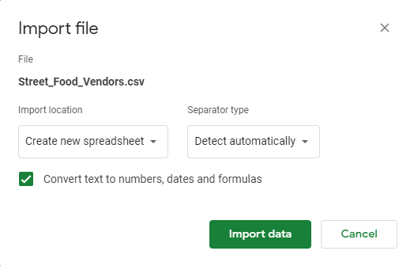
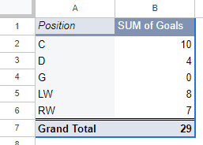

`#000000`
**Date**<br>
MPAD 2003 - Introductory Data Storytelling<br>
Emma Maxwell<br>
Jean-Sébastien Marier<br>

# Artifical Intelligence Is Giving Us Trust Issues

## Foreword
The intent with this article is to connect the relevance of society's current trust in the media and the role that Artifical Intelligence is playing in that. My hope is to open the eyes of all generations to the harm that AI is doing within the media sphere, and subsequently, our trust. 

For this assignment, you must clean and analyze the dataset from Deliverable 1, create exploratory charts/visualizations, and identify a potential story. Your assignment must clearly detail your process. You are expected to write about 1,000-1,200 words, and to include several screen captures showing the different steps you went through. Your assignment must be written with the Markdown format and submitted on GitHub.

I have been assigning different versions of this project to my digital journalism and data storytelling students for a few years now. Its structure was inspired by the main sections/chapters of [*The Data Journalism Handbook*](https://datajournalism.com/read/handbook/one/). This version was further inspired by the [Key Capabilities in Data Science](https://extendedlearning.ubc.ca/programs/key-capabilities-data-science) program offered by the University of British Columbia (UBC).

**Here are some useful resources for this assignment:**

* [GitHub's *Basic writing and formatting syntax* page](https://docs.github.com/en/get-started/writing-on-github/getting-started-with-writing-and-formatting-on-github/basic-writing-and-formatting-syntax)
* [The template repository for this assignment in case you delete something by mistake](https://github.com/jsmarier/jou4100_jou4500_mpad2003_project2_template)

Did you notice how to create a hyperlink? In Markdown, we put the clickable text between square brackets and the actual URL between parentheses.

And to create an unordered list, we simply put a star (`*`) before each item.

## Getting Data

Use two hashtag symbols (`##`) to create a level 2 heading like this one.

To include a screen capture, use the sample code below. Your images should be saved in the same folder as your `.md` file.

<br>
*Figure 1: The "Import file" prompt on Google Sheets.*

**Here are examples of functions and lines of code put in grey boxes:**

1. If you name a function, put it between "angled" quotation marks like this: `IMPORTHTML`.
1. If you want to include the entire line of code, do the same thing, albeit with your entire code: `=IMPORTHTML("https://en.wikipedia.org/wiki/China"; "table", 5)`.
1. Alternatively, you can put your code in an independent box using the template below:

``` r
=IMPORTHTML("https://en.wikipedia.org/wiki/China"; "table", 5)
```
This also shows how to create an ordered list. Simply put `1.` before each item.

This assignment is dedicated to analyzing a dataset from Ottawa's open data website. The dataset I'm looking at is titled ["Trust in Media"](https://open.ottawa.ca/datasets/ottawa::trust-in-media/about) and displays the level of trust respondants have in the news and information that they are consuming through the media. 

While there are many ways to import a dataset directly from a webpage using functions like IMPORTAHTML or IMPORTDATA, I found that the only way to import this table, due to it being sourced from Ottawa's open data webpage, was to use the built in import function from Google Sheets. To do this you open a new sheet file, go to the file tab on the top left, click the third option, import data; from there you can select a file from multiple options, I chose to upload it from my computer. Once you open that file, google sheets will ask you if you would like to select the location of the sheet and the seperator type. I chose to insert the new sheet and detect automatically. The sheet is now imported and will look something like Photo #1. 

The dataset is configured into a table with 13 coloumns and 102 rows of input. The columns are organized by year, region, question being given to each respondant, response with a scale, group type, sub-group type, percent (percent of what you may ask, that we will find out), 95lcl (lower confidence level), 95ucl (upper confidence level), language, and objectID. From and initial glance, the data looks very messy; there's submissions in both French and English, data is organized into groups and then subgroups of that, some categories are hard to decifer what they really mean or equate to, like the percent column. Overall, the data is quite hard to follow along and make logical at the moment. 


## 2. Understanding Data

### 2.1. VIMO Analysis

Use three hashtag symbols (`###`) to create a level 3 heading like this one. Please follow this template when it comes to level 1 and level 2 headings. However, you can use level 3 headings as you see fit.

Insert text here.

Support your claims by citing relevant sources. Please follow [APA guidelines for in-text citations](https://apastyle.apa.org/style-grammar-guidelines/citations).

**For example:**

As seen in Bounegru & Gray (2011), a data visualization should be clear...

### 2.2. Cleaning Data

Insert text here.

### 2.3. Analyzing Data

Insert text here.

**This section should include a screen capture of your pivot table, like so:**

<br>
*Figure 2: This pivot table shows...*

**This section should also include a screen capture of your exploratory chart, like so:**

<br>
*Figure 3: This exploratory chart shows...*

## 3. Delivering Data

Insert text here.

## 4. References

Include a list of your references here. Please follow [APA](https://apastyle.apa.org/style-grammar-guidelines/references) or [MLA](https://www.mla.org/MLA-Style) guidelines for references. Hanging paragraphs aren't required though.

**Here's an example:**

Bounegru, L., & Gray, J. (Eds.). (2021). *The Data Journalism Handbook 2: Towards A Critical Data Practice*. Amsterdam University Press. [https://ocul-crl.primo.exlibrisgroup.com/permalink/01OCUL_CRL/hgdufh/alma991022890087305153](https://ocul-crl.primo.exlibrisgroup.com/permalink/01OCUL_CRL/hgdufh/alma991022890087305153)
